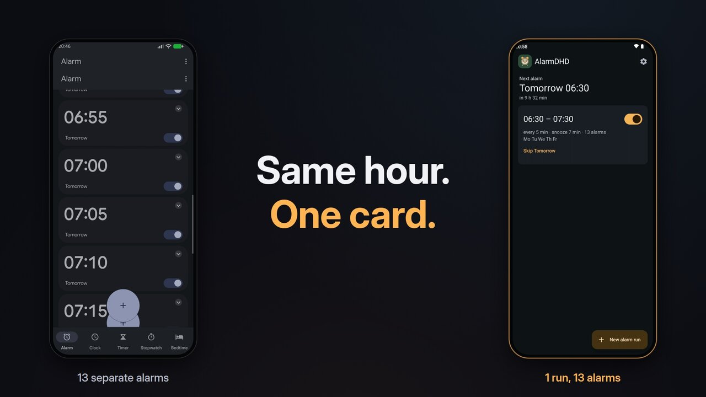
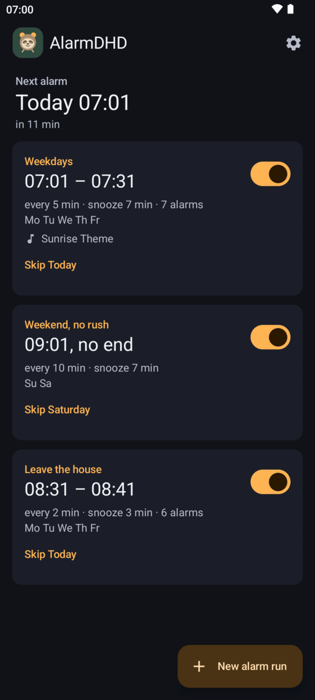
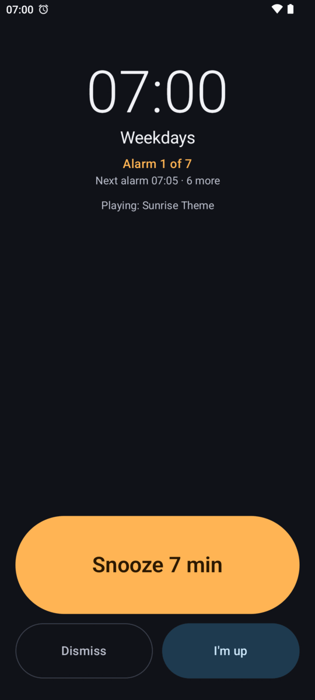
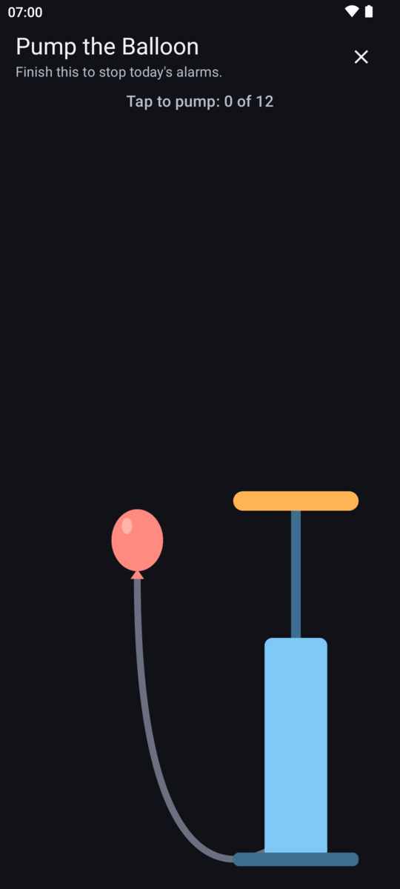
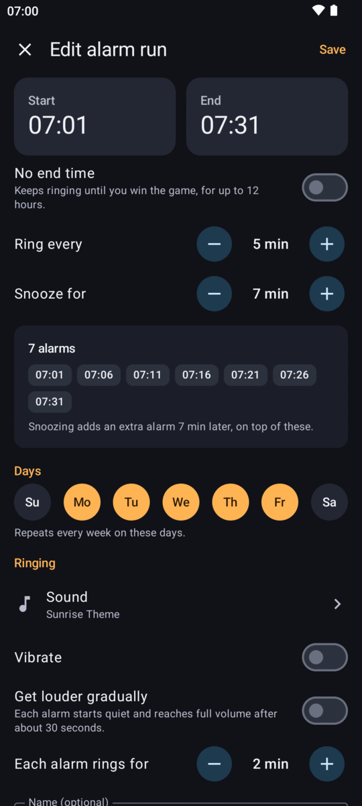
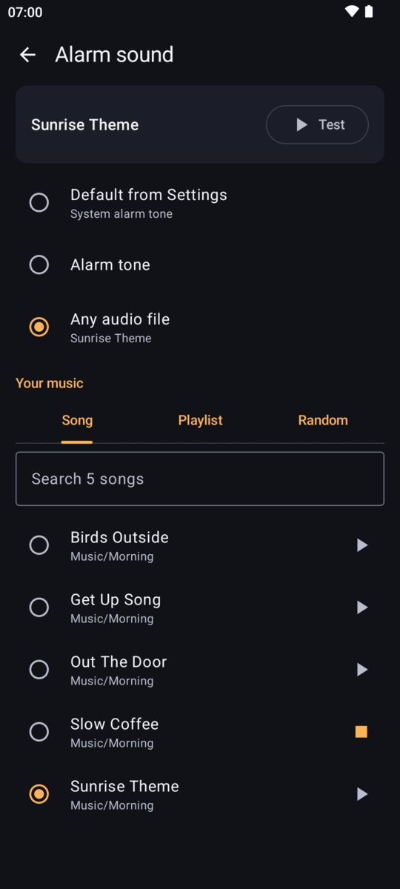
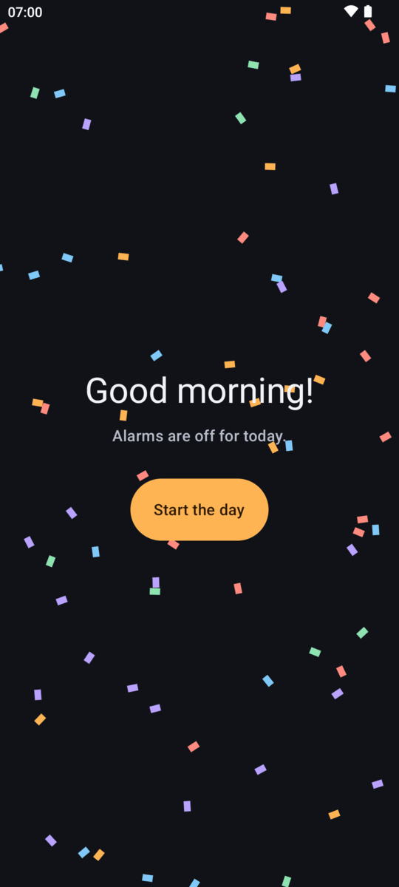

<p align="center">
  
</p>

<h1 align="center">AlarmDHD</h1>

<p align="center">An Android alarm for people who need half an hour or more to wake up.</p>

<p align="center">
  <a href="https://github.com/Rec0iL/AlarmDHD/releases/latest"><strong>Download the latest APK</strong></a>
  ·
  <a href="https://ko-fi.com/rec0il">Support me on Ko-fi</a>
</p>

<p align="center">
  <a href="https://youtu.be/DnurErs5JWU">
    
  </a>
</p>
<p align="center"><a href="https://youtu.be/DnurErs5JWU">Watch the video on YouTube</a></p>

Made with ADHD in mind, for anyone who sleeps straight through one alarm. You don't set a pile of separate alarms. You set a start time, and an end time if you want one, and it rings every few minutes until you're really up.

## How it works

Say you start at 07:00, ring every 5 minutes and snooze for 7:

| You do this | What happens |
|---|---|
| Nothing | It rings at 07:00, 07:05, 07:10 and so on |
| Snooze the 07:00 ring | An extra ring is added at 07:07 |
| Snooze the 07:05 ring | Another extra ring is added at 07:12 |
| Dismiss | This ring ends, and the run carries on |
| I'm up | The sound pauses and a short game starts |
| Win the game | The rest of today's alarms stop |

Snoozing never pushes anything back. It only adds rings, so they get closer together.

- **Stopping takes a game.** There are 10 of them, about 30 seconds each, with no timer and no way to lose. If you wander off or fall asleep on it, the alarm comes back.
- **No end time, if you want.** A run can keep going until you win the game. As a safety net it gives up after 12 hours.
- **Your own music.** One song, an `.m3u` playlist, a playlist you pick in the app, or a random song from a folder. It all plays at alarm volume, so a muted phone still wakes you.
- **It never just stays silent.** If your song is gone, it tries your other songs, then the system alarm tone, then a tone built into the app, and tells you what happened.
- **Works like a real alarm clock.** Full screen over the lock screen, gets through Do Not Disturb when alarms are allowed, and keeps working after a reboot, even before you've unlocked the phone.
- **Also:** a slow volume build-up, weekday repeats, skip next, several runs, and a home screen widget.

<p align="center">
  
  
  
</p>
<p align="center">
  
  
  
</p>

## Install

AlarmDHD isn't on the Play Store. It needs Android 9 or newer.

1. On your phone, open the [latest release](https://github.com/Rec0iL/AlarmDHD/releases/latest) and download `AlarmDHD-1.0.0.apk`.
2. Open the downloaded file. Android will ask you to allow your browser to install apps. Allow it.
3. Google Play Protect may warn you that it doesn't know this app. If it does, choose to install anyway.
4. Open AlarmDHD. The setup wizard walks you through each permission.
5. **The "Show over other apps" switch may be greyed out,** because Android blocks it for apps from outside a store. Tap the switch once, go back to the wizard and press **Open App info**. In the ⋮ menu, choose **Allow restricted settings**, then try the switch again.
6. Don't skip the test alarm at the end of the wizard. Lock your phone and let it ring, because that's the only real proof it works on your phone.

**Updating:** The app doesn't update itself. Download the new APK and install it over the old one, and your alarms stay. To hear about new versions, watch this repo's releases or use an app like [Obtainium](https://github.com/ImranR98/Obtainium).

**Checking your download:** The SHA-256 of each APK is in its release notes. Every release is signed with the same key, and its certificate's SHA-256 fingerprint is:

```
A6:C1:C6:8D:B5:20:A3:2C:B4:CD:BE:F1:03:12:EB:ED:C2:1D:63:95:11:08:3D:2B:A4:54:00:05:29:01:DA:0D
```

## What each permission is for

| Permission | Why |
|---|---|
| Exact alarms | To ring at the exact minute, even in deep sleep |
| Full-screen notifications and notifications | To show the ring screen on a locked phone |
| Show over other apps | To fill the screen while you're using the phone. Without it you only get a banner |
| Foreground service | To keep ringing once it has started |
| Battery optimisation exemption | So battery saving can't stop an alarm overnight |
| Run at startup | To set the next alarm again after a reboot |
| Vibrate and keep awake | To vibrate, and to keep the phone awake while a ring starts |

Your music folder is added through Android's own folder picker, so no storage permission is needed.

## Privacy

The app has **no internet permission**, so it can't send anything anywhere. There's no account, no ads and no analytics. Your alarms and music list stay on your phone. The Ko-fi and GitHub buttons just open your browser.

## Known limits

- **Tested on a Pixel 10 Pro with Android 17,** and on emulators for Android 9, 12 and 14. Other phones haven't been tried. Some makers' battery savers can stop alarm apps, and [Don't kill my app](https://dontkillmyapp.com) explains what to change. Please run the test alarm, and try a real morning before you rely on it.
- **No backup.** A new phone or a reinstall means setting up again.
- **Force-stopping the app cancels its alarms** until you open it again. That's how Android works.
- The app is in English only.

## Disclaimer

AlarmDHD is provided as is, without any warranty. Alarms can fail because of a bug, a phone setting, an update, a flat battery or how the app was set up. You use it at your own risk. To the extent the law allows, the developer is not liable for you oversleeping or for anything that follows from it, such as being late or missing an appointment, a job or a flight, whether it was caused by user error or a bug. If something really matters, set a second alarm on another device.

## Support

If this gets you out of bed in the morning, you can [buy me a coffee on Ko-fi](https://ko-fi.com/rec0il).

## Build it yourself

You need Android Studio, or JDK 17 or newer with the Android SDK. Android Studio's own JDK works: point `JAVA_HOME` at it if your system Java has no compiler.

Run the tests:

```bash
./gradlew :app:testDebugUnitTest
```

Install on a connected phone:

```bash
./gradlew :app:installDebug
```

The release signing key isn't in this repo, so your own release builds come out unsigned. `app/build.gradle.kts` shows where it looks for a key.

## How it's put together

- `model/Planner.kt` holds every timing rule (when things ring, stacking, open end, midnight, daylight saving). It's plain Kotlin with no Android in it, so the tests cover it directly.
- `sound/SoundChain.kt` holds the fallback order: chosen song, other songs, system tone, bundled tone. Also plain Kotlin, also tested directly.
- `sound/VolumeRamp.kt` brings a ring from quiet to full volume when gradual volume is on. Anything going wrong ends the ramp at full volume, so a problem can never leave an alarm stuck quiet.
- `alarm/AlarmEngine.kt` schedules exactly one ringing system alarm at a time, always the next ring, from saved state. Reboots, clock changes and updates all just call `reschedule()` again.
- `widget/` holds the home screen widget. `reschedule()` refreshes it last, and a failed refresh can't affect the alarm. While a widget exists, one extra silent system alarm updates it at midnight.
- `alarm/RingService.kt` runs a ring from start to finish, and stays alive in a silent paused mode during the game. The next alarm is scheduled before ringing starts, so a crash can't end a run.
- `data/AlarmStore.kt` keeps state in device-protected storage, so alarms ring after an overnight reboot even before the phone has been unlocked.

### Adding a game

Implement `MiniGame` in a new file under `game/` and add it to `MiniGames.all`. Nothing else changes. `game/GameParts.kt` has the pieces the games share: status line, win pause and brush.

Every game must follow these rules: no way to lose, no timer, no penalty for wrong moves, about 30 seconds or less, always winnable, and it works with TalkBack. Winning a game is the only way to stop the day's alarms early, so a game that can't be finished would trap someone with a ringing phone.
